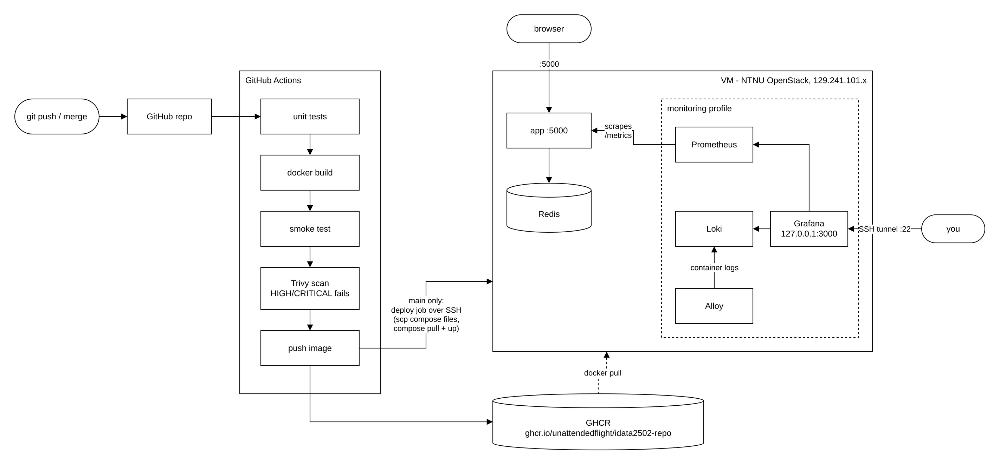

# IDATA2502 app

A small flask app with a visit counter
its built, scanned and pushed by github actions, deployed over ssh to a vm at
nynu openstack that terraform creates and asible configures, and watched by
prometheus, loki and grafana on the same vm.

## Architecture




- **PRs** run the same build workflow (test, build, smoke test, trivy) and push
  an image tagged with the branch name. **merges to `main`** push `latest` and
  then deploy
- only ports **22** and **5000** are open in the security group. grafana listens
  on the vms loopback and is reached through ssh tunnel
- every action in the workflows is pinned to a full commit SHA, with the
  version in a comment, a moved tag cant change what runs

## Repo layout

| Path | What |
|---|---|
| `.github/workflows/` | CI/CD: `build.yml` (test, build, trivy, push), `pr.yml`, `main.yml` (build and deploy), `release.yml`, `tag.yml` |
| `app/` | the flask app, its tests and its dockerfile |
| `ansible/` | `site.yml` configures a fresh ubuntu host. inventories for the vm and the local lab server |
| `monitoring/` | prometheus, loki, alloy and grafana, all in the `monitoring` compose profile |
| `terraform/cloud/` | the vm at ntnu openstack: key pair, security group, instance |
| `terraform/local/` | the local lab server (container with SSH on :2222), the offline test target for the playbook |
| `scripts/` | build metadata (`build_env.sh`, `version.sh`) and `compose.sh` for local runs |
| `docs/` | cost estimate and risk assessment (ROS) |
| `compose.yml` | app and redis. includes `monitoring/compose.yaml` |
| `Makefile` | shortcuts for terraform, ansible and secrets (`make help`) |

## Run locally

```bash
cp .env.example .env                          # then set API_KEY
./scripts/compose.sh up -d --build            # app + redis on http://localhost:5000
./scripts/compose.sh --profile monitoring up -d --build   # + the stack, grafana on http://localhost:3000 (admin/admin)
```

to try playbook changes without touching the vm, use the local lab server:
`make apply` creates it from `terraform/local/`, and `make ansible-local` runs
`site.yml` against it.

## Rebuild from scratch

needs `~/.config/openstack/clouds.yaml`, `terraform/cloud/terraform.tfvars`,
the ntnu vpn (for the terraform steps when off campus) and `gh` logged in.

```bash
terraform -chdir=terraform/cloud init   # first time on a machine
make rebuild                            # destroy -> apply -> inventory -> playbook -> VM_HOST secret
gh workflow run main.yml                # build, push and deploy the app and the monitoring stack
```

`make rebuild` runs: `cloud-destroy`, `cloud-apply`, `inventory` (writes ip into `ansible/inventory.ini`), `ansible`
(waits for ssh, then configures the vm and authorizes the deploy key) and
`host-secret` (updates `VM_HOST`). the other secrets survive a rebuild.

if openstack hands out an ip you have used before, ssh refuses the new host key:
`ssh-keygen -R <ip>` and run again.

## Secrets

| Secret | In | Used for |
|---|---|---|
| `VM_HOST` | github secrets (set by `make host-secret`) | where the deploy job connects |
| `VM_SSH_KEY` | github secrets. the public half in `~ubuntu/.ssh/authorized_keys` on the vm (put there by ansible) | the deploy jobs ssh login, only used by github actions |
| `API_KEY` | github secrets -> written to `/opt/app/.env` on the vm by the deploy job | `X-API-Key` for `POST /reset` |
| `GRAFANA_PASSWORD` | github secrets -> `/opt/app/.env` on the vm | frafanas `admin` password |

`/opt/app/.env` on the vm is `chmod 600` and rewritten on every deploy. 
the registry login uses the workflow's own `GITHUB_TOKEN`
no personal token is stored anywhere

**not in the repo:** openstack creds, `terraform.tfvars`,
terraform state files (`*.tfstate`), `ansible/inventory.ini` (the vms ip),
`.env`, and private key. these are in `.gitignore`
only `terraform.tfvars.example`, `inventory.ini.example` and `.env.example` are
committed.
if a secret somehow lands in a commit, rotatte it, deleting it in a late commit leaves it in the history

## Monitoring

grafana is not exposed to the internet. open a tunnel and go to
<http://localhost:3000>:

```bash
ssh -L 3000:localhost:3000 ubuntu@<vm-ip>
```

log in as `admin` with the `GRAFANA_PASSWORD` value
(`grep GRAFANA_PASSWORD /opt/app/.env` on the vm).
the provisioned **App** dashboard shows whether the app is up,requests per second by route, p95 latency, the 5xx rate and the apps logs.
